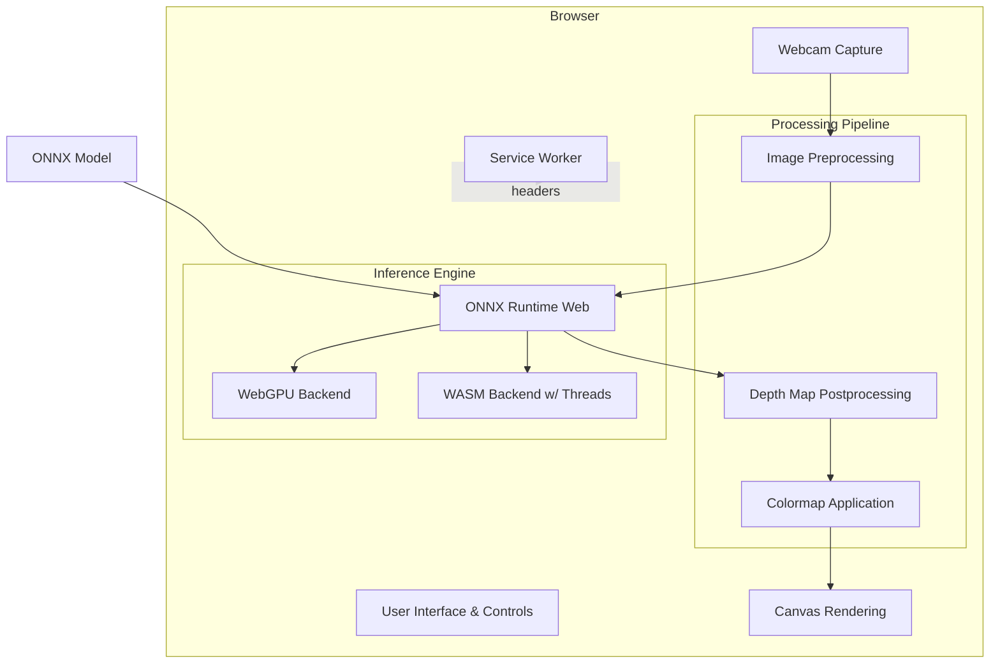

# Architecture of Depth Anything V2 JS

This document outlines the architecture of the browser-based Depth Anything V2 implementation. The application is a pure client-side single-page application (SPA) that leverages modern Web APIs to perform real-time depth estimation using a webcam.

## High-Level Overview

The system is designed to run the Depth Anything V2 machine learning model entirely within the user's browser, ensuring privacy and eliminating the need for a backend server. It relies on ONNX Runtime Web (ORT) for executing the model and takes advantage of WebGPU or WebAssembly (WASM) for hardware acceleration.

## Core Components

### 1. Main Application (`index.html`)
The main entry point contains the HTML structure, CSS styling, and the core JavaScript logic. 
- **Initialization**: Sets up the model session, negotiates the backend (WebGPU vs. WASM), and prepares the UI.
- **Render Loop**: Continuously requests animation frames, extracts the latest video frame, runs inference, and renders the result.
- **Controls**: Allows the user to select the execution backend, adjust the input resolution for performance/quality tradeoffs, and choose the output colormap.

### 2. Inference Engine (`js/libraries/ort/`)
The application bundles **ONNX Runtime Web**, a JavaScript library that can run ONNX models in the browser. 
- The model itself (`models/depth-anything-v2-small_fp16.onnx`) is fetched asynchronously on startup.
- Depending on the browser's capabilities, ORT routes the computation to **WebGPU** (for maximum performance via the GPU) or **WASM** (CPU fallback).

### 3. Service Worker / Cross-Origin Isolation (`worker.js`)
To achieve high performance on the CPU (WASM backend), the application requires multithreading, which depends on `SharedArrayBuffer`. Browsers restrict `SharedArrayBuffer` to cross-origin isolated contexts for security reasons.
- `worker.js` acts as a service worker that intercepts all network requests and injects `Cross-Origin-Embedder-Policy` (COEP) and `Cross-Origin-Opener-Policy` (COOP) headers.
- This "hack" (adapted from `coi-serviceworker`) allows the app to be fully multithreaded even when hosted on static platforms like GitHub Pages that do not support setting custom HTTP headers.

### 4. Local Development Scripts (`run.bat`, `run.command`)
Because Service Workers and Web Workers cannot be instantiated from `file://` URLs, the project includes simple helper scripts to launch a local Python HTTP server (`python3 -m http.server`) for development and testing.

## Data Pipeline

1. **Capture**: The browser's `navigator.mediaDevices.getUserMedia` API connects to the webcam. Frames are played back in a `<video>` element.
2. **Preprocessing**: 
    - The current video frame is drawn onto an `OffscreenCanvas`.
    - It is resized so the short side matches the user's selected resolution, and the long side is scaled to preserve aspect ratio (rounded to a multiple of 14px, the Vision Transformer patch size).
    - Image data is extracted, normalized using ImageNet mean/standard deviation constants, and flattened into a planar RGB `Float32Array`.
3. **Inference**: The `Float32Array` is converted into an `ort.Tensor` and passed to the active ONNX Runtime session.
4. **Postprocessing**: The model outputs a tensor representing relative inverse depth. The output is min-max normalized on a per-frame basis to stretch the depth values across a 0-255 scale.
5. **Rendering**: The normalized depth is fed through a lookup table (LUT) to apply a color map (either greyscale or a polynomial approximation of the Google Turbo colormap). The resulting colored pixels are pushed to the output `<canvas>`.
